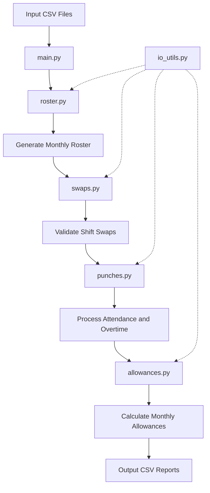
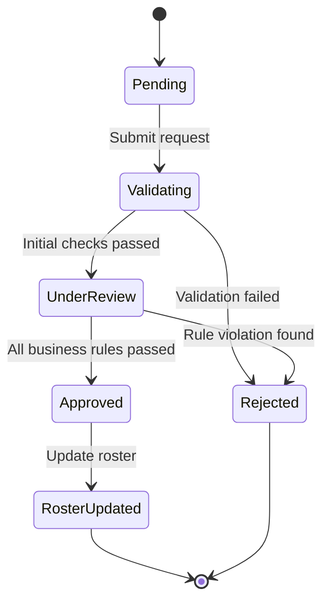

# T078-PS-056 – Shift Roster and Overtime Engine

## 1. Glossary

| Term | Meaning |
|---|---|
| Agent | An employee who is assigned shifts. |
| Shift | A defined working period, such as Morning, Evening or Night. |
| Roster | A monthly schedule showing the shifts assigned to each agent. |
| Weekly Off | The designated rest day assigned to an agent during a week. |
| Skill | The work category an agent is qualified for, such as Voice, Chat or Email. |
| Demand | The number of agents required for a particular shift and skill on a specific date. |
| Shift Swap | A request made by two agents to exchange their assigned shifts or arrange an off-day swap. |
| Punch-In | The recorded time when an agent starts work. |
| Punch-Out | The recorded time when an agent finishes work. |
| Attendance | The record of an agent's actual working time based on punch-in and punch-out data. |
| Overtime | Working time beyond the regular weekly threshold, subject to the configured limits. |
| Regular Hours | The first 48 eligible working hours in a week, as configured in the current system. |
| Night Hours | Working time that overlaps with the 10 PM to 6 AM period. |
| Allowance | An additional payment amount calculated by the monthly allowance module. |
| Violation | A condition that breaks a configured scheduling or attendance rule. |
| Shortfall | The number of required agent positions that could not be filled. |
| CSV | Comma-Separated Values, the file format used for project input and output. |

### Abbreviations

- **OT:** Overtime
- **CSV:** Comma-Separated Values
- **BR:** Business Rule
- **ID:** Identifier
- **OFF:** Weekly off or non-working day in the roster

**Note:** The hour limits and time windows in this glossary describe the current project configuration. They should not be treated as a statement of legal compliance without checking the applicable labour-law requirements.
---

## 2. System Design Diagram

The Shift Roster and Overtime Engine is divided into different Python modules. Each module performs a specific task, and the main program coordinates the complete workflow.

### Module Responsibilities

| Module | Responsibility |
|---|---|
| main.py | Controls and executes the complete project workflow. |
| roster.py | Generates monthly employee shift rosters based on demand and scheduling rules. |
| swaps.py | Processes and validates employee shift swap requests. |
| punches.py | Processes attendance records, calculates working hours and identifies violations. |
| allowances.py | Calculates monthly employee allowances. |
| io_utils.py | Reads input CSV files and writes output CSV reports. |

### System Architecture Diagram

### Workflow Explanation

1. Input data is read from CSV files.
2. The roster module generates the monthly shift schedule.
3. The swap module checks and processes shift exchange requests.
4. The punch module calculates attendance, working hours and overtime.
5. The allowance module calculates monthly allowances.
6. Final reports are generated and saved as CSV files.
   ## 3. State Diagram

### 3.1 Shift Swap Request State Diagram

The following state diagram represents the different states of a shift swap request, from submission to approval or rejection.

### 3.2 Description of States

| State | Description |
|---|---|
| Pending | The employee's shift swap request has been submitted. |
| Validating | The system checks employee details, requested shifts and timing. |
| UnderReview | The system checks scheduling rules for both employees. |
| Approved | The swap request passes all required validations. |
| Rejected | The swap request fails one or more validations. |
| RosterUpdated | The approved shift swap is reflected in the roster. |

**Note:** This diagram represents the logical states of a swap request. The project processes these checks through code rather than maintaining a separate state-tracking system.
## 4. Business Rule Register

The following business rules define how the Shift Roster and Overtime Engine processes employee schedules, shift swaps, attendance and overtime.

| Rule ID | Business Rule |
|---|---|
| BR-01 | An employee must have the required skill to be assigned to a shift. |
| BR-02 | An employee can be assigned only one shift per day. |
| BR-03 | The roster should provide a weekly off based on the employee's preferred off day, wherever possible. |
| BR-04 | An employee must have at least 12 hours of rest between consecutive shifts. |
| BR-05 | An employee must not work more than 6 consecutive days. |
| BR-06 | An employee must complete 90 days from the joining date before being assigned a night shift. |
| BR-07 | An employee must not work more than 7 consecutive night shifts. |
| BR-08 | Weekly working hours must not exceed the configured limit of 60 hours. |
| BR-09 | The first 48 eligible weekly hours are treated as regular hours; additional eligible hours are treated as overtime, subject to the configured quarterly overtime limit. |
| BR-10 | Quarterly overtime must not exceed the configured limit of 125 hours. |
| BR-11 | A shift swap request must involve two different valid employee IDs. |
| BR-12 | A shift swap request must match the employees' existing roster assignments. |
| BR-13 | A shift swap request must be submitted at least 24 hours before the earliest shift involved. |
| BR-14 | Both employees must satisfy the scheduling rules after the proposed swap. |
| BR-15 | An employee can have a maximum of 4 approved shift swaps per month. |
| BR-16 | Punch records must contain valid employee IDs and valid timestamps. |
| BR-17 | Duplicate valid punch records for the same employee and date are not accepted. |
| BR-18 | Punch-in and punch-out records must correspond to a valid roster assignment. |
| BR-19 | Daily payable working hours are limited to 9 hours. |
| BR-20 | An unpaid break is deducted when the recorded working duration reaches the configured break threshold. |
| BR-21 | A late arrival exceeding the 10-minute tolerance is subject to a deduction rounded up to the next 15-minute block. |
| BR-22 | Employees working less than 4 hours are marked as half-day. |
| BR-23 | Night hours are calculated for work performed between 10 PM and 6 AM. |
| BR-24 | Monthly allowances are calculated using the configured allowance rules and employee work records. |
| BR-25 | Scheduling shortfalls and detected violations are recorded in the output reports. |

### 4.1 Important Configuration Note

The hour limits and time windows listed above represent the rules configured in this project. They should not be treated as confirmation of compliance with every applicable labour law. Actual legal requirements may vary depending on the location and employment category.
